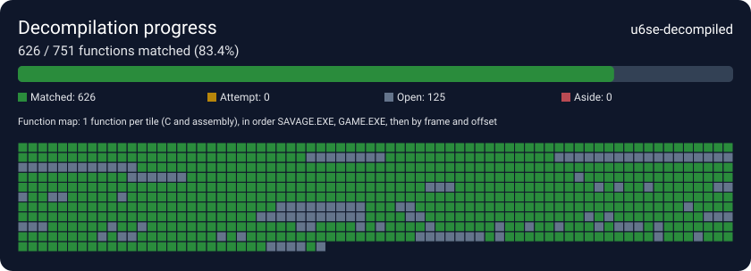

# The Savage Empire, decompiled

C and assembly sources that rebuild the executables of *Worlds of Ultima: The Savage Empire*
(Origin Systems, 1990). Each one comes out byte for byte equal to the GOG release's,
header and relocation table included.

| Program | Sources | Status |
|---|---|---|
| `SAVAGE.EXE` (launcher, title, intro, character creation, endgame) | `SRC_S/` | identical |
| `GAME.EXE` (the game) | `SRC/` | identical |
| `INSTALL.EXE` | — | not started |

The game runs on Ultima VI's engine, and GAME.EXE was decompiled starting from the
readable Ultima VI decompilation, [u6-decompiled](https://github.com/KarlClinckspoor/u6-decompiled).

One tile per function of `SRC_S/` (SAVAGE.EXE) and `SRC/` (GAME.EXE), C and assembly, regenerated by
`python3 tools/progress.py`. Grey tiles are the 125 routines (38 in SAVAGE.EXE, 87 in GAME.EXE) that still have an
address placeholder (`C_SSSS_OOOO`) for a name. INSTALL.EXE is not started and has no tiles. The count reads the
sources only; `tools/se/secheck.py` is the byte-for-byte check.

## Reading

- [`docs/WRITEUP.md`](docs/WRITEUP.md): what the decompilation taught. How the compiler was
  identified, Turbo C++ 1.00's code-shape rules, what the link needed, and how Savage
  Empire differs from Ultima VI.
- [`docs/MECHANICS.md`](docs/MECHANICS.md): how the game plays, read from the code.
  Conversations and quest flags, time and rest, stats and levels, and combat.
- [`docs/FINDINGS.md`](docs/FINDINGS.md): the engine compared with Ultima VI's, point by point.
- [`docs/MAP.md`](docs/MAP.md): the layout of both executables.
- [`SRC_S/DECOMP.md`](SRC_S/DECOMP.md), [`SRC/DECOMP.md`](SRC/DECOMP.md): the rules of the
  sources and the status of each program; `modules.txt` in each folder lists the modules
  in link order.
- [`docs/GAME_NOTES.md`](docs/GAME_NOTES.md): compiler lessons, module by module.

## Exporting the dialogue

`tools/se/dialogue_export.py` (Python 3, no dependencies; ported from u6-decompiled's exporter)
disassembles the 68 conversation scripts of `TALK.LZC` and writes them as JSON. The result
for the GOG release is in [`dialogue.json`](dialogue.json).

    python3 tools/se/dialogue_export.py -o dialogue.json              # every script: text, IF/ELSE, GOTOs, flags, keyword blocks
    python3 tools/se/dialogue_export.py --format text --name aiela    # only the words, per keyword
    python3 tools/se/dialogue_export.py --check                       # disassemble everything, report problems

It reads `gamedata/SAVAGE/` by default (`-d` or `SE_GAMEDIR` for another folder). The walk is
static, so every branch of every IF is exported. Text keeps the engine's escapes (`$P`, `#K`,
`*`, `@word`); see "Conversations" in `docs/MECHANICS.md`. Script entry *i* belongs to NPC *i*+2;
entries 0x3E-0x48 are shared by eight NPCs each. Entry 54 (NPC 0x38) contains a malformed
`$2 := ...` that the engine ignores; it is exported as `bad_let`.

## Building

You need the game and the original tools; neither is in this repository.

- The GOG release's `SAVAGE.EXE` and `GAME.EXE` in `gamedata/SAVAGE/` (or set `SE_GAMEDIR`).
- Turbo C++ 1.00 and 1.01, as the disk-image archives `tools/Borland Turbo CPP 1.00 5.25-360k.7z`
  and `tools/Borland Turbo C__ 1.01 3.5.7z`.
- MASM 3.0: `MASM.EXE`, or a floppy image holding it, in `tools/masm300/`.
- DOSBox or DOSBox-X, Python 3 with `py7zr` and `capstone`, mtools, and Info-ZIP `unzip`.

Then:

    python3 tools/se/setup.py                    # unpack the compilers, build CMSE.LIB
    python3 tools/se/sebuild.py --target savage  # build SAVAGE.EXE, compare with the original
    python3 tools/se/sebuild.py --target game    # build GAME.EXE, compare with the original
    python3 tools/se/secheck.py --target game    # compare every module on its own

The toolchain is Origin's: Turbo C++ 1.00 (`TCC`, `C0M.OBJ`, `CM.LIB` with three modules
from 1.01) and TLINK 3.0, with MASM 3.0 standing in for TASM. `tools/se/` holds the tools.
Every one takes `--target savage|game`; the DECOMP.md files list them.
